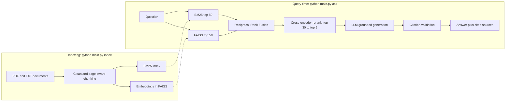

<div align="center">

# AI Risk & Regulatory Intelligence Platform

**Ask questions about regulations and risk frameworks, and get answers you can trace back to the source page.**

A retrieval-augmented generation (RAG) system combining hybrid search, cross-encoder reranking and
citation-grounded LLM answers, with a built-in retrieval evaluation harness.


</div>

> **Results at a glance.** On a 60-question LLM-generated evaluation set, hybrid retrieval with cross-encoder
> reranking put the supporting passage in the top 5 for 85% of questions (BM25 alone: 78%) and raised MRR from
> 0.62 (BM25) to 0.73. See [Evaluation](#evaluation) for the method and its limits.

---

## Table of contents

- [Why this exists](#why-this-exists)
- [Features](#features)
- [Architecture](#architecture)
- [Quickstart](#quickstart)
- [Usage](#usage)
- [Local LLM notes](#local-llm-notes)
- [Document corpus](#document-corpus)
- [Evaluation](#evaluation)
- [Configuration](#configuration)
- [Project structure](#project-structure)
- [Design decisions](#design-decisions)
- [Limitations](#limitations)
- [Roadmap](#roadmap)
- [Troubleshooting](#troubleshooting)
- [Testing](#testing)
- [Disclaimer](#disclaimer)
- [Acknowledgements](#acknowledgements)
- [License](#license)

## Why this exists

Risk and compliance teams spend a lot of time hunting through long regulatory texts (frameworks,
laws, supervisory guidance) to answer questions like *"What does this require of us?"* or *"Which
control addresses this risk?"*. Plain keyword search misses paraphrases, and plain LLM chat invents
article numbers. This project is a small, inspectable system that:

1. finds the relevant passages using **both** exact-term and semantic search,
2. re-scores them with a **cross-encoder** so the best evidence reaches the model,
3. makes the LLM answer **only from those passages** and cite them, and
4. **measures** retrieval quality (Precision@K / Recall@K) instead of assuming it works.

## Features

- **Hybrid retrieval**: BM25 keyword search plus dense embeddings in FAISS, fused with Reciprocal Rank Fusion (or a weighted score blend).
- **Cross-encoder reranking**: re-scores the fused shortlist with a `(query, passage)` model for much finer relevance.
- **Grounded generation with citations**: numbered context, strict "answer only from the passages" prompt, automatic abstention when the documents don't cover the question.
- **Citation validation**: flags citation numbers that were never in the context, and answers with no valid citation.
- **Page-level traceability**: every chunk carries its source document and PDF page range.
- **Pluggable LLM**: hosted Claude via the Anthropic API, or any local Hugging Face chat model.
- **Evaluation harness**: Precision@K, Recall@K, Hit@K and MRR across BM25, dense, hybrid and hybrid + rerank, with an LLM-assisted eval-set builder.
- **Beginner-friendly to run**: a menu you can launch from IDLE with F5 (no command line needed), plus a full CLI.
- **Model-free unit tests** for chunking, fusion, citation parsing, config loading and metric arithmetic.

## Architecture



| Stage | Default | Where |
|---|---|---|
| Chunking | 220 words, 40-word overlap, sentence-aware, spans page breaks | `regintel/ingest.py` |
| Sparse retrieval | BM25 Okapi (`k1=1.5`, `b=0.75`), Porter-stemmed tokens | `regintel/index.py` |
| Dense retrieval | `BAAI/bge-small-en-v1.5`, normalised, FAISS `IndexFlatIP` (cosine) | `regintel/index.py` |
| Fusion | Reciprocal Rank Fusion, `k=60`, top 50 from each retriever | `regintel/retrieval.py` |
| Reranker | `cross-encoder/ms-marco-MiniLM-L-6-v2` over the top 30 | `regintel/reranker.py` |
| Generator | Claude (`claude-sonnet-5-5`) or a local model such as `Qwen/Qwen2.5-3B-Instruct` | `regintel/llm.py` |
| Context size | top 5 reranked passages | `regintel/pipeline.py` |

## Quickstart

**Requirements:** Python 3.10+ and about 2 GB of disk for the search models. A local LLM adds roughly 6 GB (3B model)
to 15 GB (7B model), and a GPU is strongly recommended for those. The hosted Claude API needs no local model.

```bash
git clone https://github.com/<your-username>/ai-risk-regulatory-rag.git
cd ai-risk-regulatory-rag

python -m venv .venv
source .venv/bin/activate          # Windows: .venv\Scripts\activate
pip install -r requirements.txt

cp .env.example .env               # then edit .env (see below)
```

Choose your LLM in `.env` (the file sits next to `main.py` and is named exactly `.env`):

```bash
# Option A: hosted Claude (best answer quality; needs an API key from the Claude Console)
LLM_PROVIDER=anthropic
ANTHROPIC_API_KEY=your-key-here
ANTHROPIC_MODEL=claude-sonnet-5-5

# Option B: local open-weights model (private, no key, slower without a GPU)
LLM_PROVIDER=hf
HF_LLM_MODEL=Qwen/Qwen2.5-3B-Instruct
```

Build the corpus and the indexes, then ask something:

```bash
python main.py download            # fetch the public PDFs into data/raw/
python main.py index               # clean, chunk, build BM25 + FAISS indexes
python main.py ask "What are the four core functions of the NIST AI Risk Management Framework?"
```

### Running from IDLE (no command line)

1. Open `main.py` in IDLE and press **F5** (Run > Run Module).
2. A numbered menu appears in the Shell: **1** install dependencies, **2** download documents, **3** build the index,
   **4** ask a question, **5** chat, **6** generate an eval set, **7** run the evaluation, **8** run unit tests,
   **9** check or resume the local LLM download (percent, speed, time left),
   **s** show setup status (what's missing and the next step).
3. Create the `.env` file described above, then press F5 again after any edit.

Models stay loaded between questions while the menu is open, so only the first question is slow. To run a single
fixed command on F5 and skip the menu, set `IDLE_ARGS` near the top of `main.py`, for example
`IDLE_ARGS = ["ask", "What does the EU AI Act require for high-risk systems?"]`.

## Usage

```bash
# One question (default: hybrid retrieval + rerank, 5 passages)
python main.py ask "How should model validation be performed?"

# Inspect exactly what the LLM saw
python main.py ask "What is a data protection impact assessment?" --show-context

# Compare retrieval strategies on one question (bm25 | dense | hybrid | hybrid_rerank)
python main.py ask "incident reporting for ICT third-party providers" --mode bm25

# Machine-readable output (answer, citations, full context with scores)
python main.py ask "..." --json

# Interactive loop
python main.py chat

# Local LLM (LLM_PROVIDER=hf): how much is downloaded? start / resume with live progress
python main.py model
python main.py model --download

# Setup check and unit tests
python main.py status
python main.py test
```

Use it from Python:

```python
from regintel.pipeline import RAGPipeline

pipe = RAGPipeline()
result = pipe.ask("What does the framework say about the Govern function?")

print(result.answer)
for c in result.citations:
    print(c.ref, c.title, c.pages, c.rerank_score)
print(result.warnings)        # e.g. invalid citation numbers
```

**Output shape** (replace with a real run from your own corpus for the repo's demo):

```text
Q: <your question>

A: <answer text with inline citations> [1][3]

Sources cited:
  [1] <Document title>, pp. <start>-<end>  (rerank <score>)
      <source URL>
      <first ~170 characters of the supporting passage> ...
  [3] <Document title>, p. <page>  (rerank <score>)
      ...
```

If the documents don't contain the answer, the system says so and cites nothing rather than guessing.

## Local LLM notes

- **Downloaded once.** A local model is stored in the Hugging Face cache (`~/.cache/huggingface/hub`, or
  `%USERPROFILE%\.cache\huggingface\hub` on Windows) and loaded from disk on later runs. It only downloads again if
  you change `HF_LLM_MODEL`, delete the cache folder, or move the cache.
- **Progress and resuming.** `python main.py model` (IDLE menu option 9) shows how much is downloaded and can
  start or resume the download with live progress. IDLE can't render the usual progress bars, so use this before
  your first question.
- **Moving or locking the cache.** Add `HF_HOME=D:\hf_models` to `.env` to store models elsewhere. Once a download
  is complete, `HF_HUB_OFFLINE=1` makes later runs fully offline.
- **Memory.** A 7B model needs roughly 15 GB in half precision. If you see *"Some parameters are on the meta
  device because they were offloaded to the disk and cpu"*, the model didn't fit in memory and some layers spilled to
  CPU and disk: it still runs but very slowly. Use a smaller model (`Qwen/Qwen2.5-3B-Instruct` or `1.5B`) or the hosted API.
- Retrieval, reranking and the evaluation harness do not use the LLM at all.

## Document corpus

`python main.py download` fetches eight free public documents on AI governance and the model, data and
ICT risk rules around it:

| File | Document | Covers |
|---|---|---|
| `nist_ai_rmf_1_0.pdf` | NIST AI Risk Management Framework 1.0 (AI 100-1) | Govern / Map / Measure / Manage, trustworthiness |
| `nist_ai_600_1_genai_profile.pdf` | NIST AI 600-1, Generative AI Profile | GenAI-specific risks and suggested actions |
| `nist_csf_2_0.pdf` | NIST Cybersecurity Framework 2.0 | Cyber risk functions and outcomes |
| `eu_ai_act_2024_1689.pdf` | EU AI Act, Regulation (EU) 2024/1689 | Risk tiers, high-risk obligations, penalties |
| `eu_gdpr_2016_679.pdf` | GDPR, Regulation (EU) 2016/679 | Data protection principles, DPIAs |
| `eu_dora_2022_2554.pdf` | DORA, Regulation (EU) 2022/2554 | ICT risk, incident reporting, third-party risk |
| `fed_sr_11_7_model_risk.pdf` | Federal Reserve SR 11-7 | Model risk management and validation |
| `bcbs_239_risk_data_aggregation.pdf` | BCBS 239 | Risk data aggregation and reporting |

**Bring your own documents:** put any `.pdf` or `.txt` files in `data/raw/` and re-run `python main.py index`.
To get readable titles and URLs in citations, add entries to `data/raw/sources.json`:

```json
{ "my_policy.pdf": { "title": "Internal Model Governance Policy v3", "url": "https://intranet/..." } }
```

Notes:

- EUR-Lex often blocks scripted downloads. The downloader lists any failures; open the URL in a browser, save the PDF into `data/raw/` under the same file name, then run `index`.
- Regulations are amended and consolidated. Check the publisher for current versions before relying on an answer.
- Citation page numbers are **PDF page indices**, which can differ from the printed page numbers.
- Scanned PDFs need OCR before ingestion.

## Evaluation

Retrieval quality is measured with **Precision@K** and **Recall@K** (plus Hit@K and MRR), separately for
BM25, dense, hybrid, and hybrid + rerank, so you can see what each component contributes.

### Method

- **Gold set:** 60 questions generated by an LLM from chunks sampled round-robin across the documents. Each question
  comes with one verbatim evidence sentence from its source chunk (verified to exist in it).
- **Relevance:** a retrieved chunk is relevant if it contains an evidence snippet (case- and punctuation-insensitive).
  Labelling with text rather than chunk IDs keeps the gold set valid when you change chunk size, embedding model or
  retriever. `eval` also checks that every snippet exists in the corpus and warns about any that don't.

| Metric | Definition |
|---|---|
| Precision@K | relevant chunks in the top K ÷ K |
| Recall@K | distinct evidence snippets covered by the top K ÷ total snippets |
| Hit@K | 1 if any relevant chunk is in the top K |
| MRR | mean of 1 ÷ (rank of the first relevant chunk) |

### Results (60 questions, default settings)

Recall@K and MRR (best per column in bold). With one evidence snippet per question, Recall@K equals Hit@K:

| Mode | R@1 | R@3 | R@5 | R@10 | MRR |
|---|---|---|---|---|---|
| BM25 | 0.483 | 0.750 | 0.783 | 0.833 | 0.616 |
| Dense (FAISS) | 0.467 | 0.683 | 0.767 | 0.850 | 0.592 |
| Hybrid (RRF) | 0.600 | 0.767 | 0.783 | **0.900** | 0.695 |
| Hybrid + cross-encoder | **0.650** | **0.817** | **0.850** | 0.867 | **0.732** |

Precision@K:

| Mode | P@1 | P@3 | P@5 | P@10 |
|---|---|---|---|---|
| BM25 | 0.483 | 0.278 | **0.187** | **0.108** |
| Dense (FAISS) | 0.467 | 0.244 | 0.170 | 0.100 |
| Hybrid (RRF) | 0.600 | 0.278 | 0.183 | 0.107 |
| Hybrid + cross-encoder | **0.650** | **0.289** | **0.187** | 0.102 |

### Reading the results

- **Hybrid beats either retriever alone at the top of the ranking:** Hit@1 0.60 vs 0.48 (BM25) and 0.47 (dense); MRR 0.69 vs 0.62 and 0.59.
- **Reranking helps most within the top 5, which is what the LLM receives:** Hit@5 0.85 vs 0.78 for plain hybrid, and Hit@1 0.65.
- **At K=10 the reranker is slightly behind plain hybrid** (0.867 vs 0.900, two questions out of 60). A general-purpose MS MARCO cross-encoder may mis-order some legal text; trying a stronger or domain-tuned reranker is on the roadmap.
- **Precision@K is bounded by design.** With one relevant passage per question it can't exceed about 1/K, so compare modes with each other rather than against 1.0. P@10 slightly above 0.1 happens because overlapping chunks can both contain the evidence.

### Limits of this evaluation

- **Small sample.** One question is 1.7 percentage points, so differences of a few questions between modes are suggestive, not statistically conclusive.
- **Synthetic questions.** LLM-written questions share wording with their source passage, which tends to flatter keyword search and inflate absolute scores compared with real analyst questions.
- **Unaudited misses.** Five questions fail in every retrieval mode at K=10. They are likely to be ambiguous questions or evidence-label problems rather than retrieval failures, but they have not been audited yet.
- **Retrieval only.** The harness does not measure whether generated answers are faithful to the cited passages.

### Reproduce

```bash
python main.py make-evalset --n 60      # bootstrap questions with an LLM -> data/eval/eval_set.jsonl
# review the file: delete weak questions and add your own (format below)
python main.py eval --ks 1 3 5 10       # prints the comparison, saves data/eval/results.json
```

Gold-set format, one JSON object per line. `evidence` holds short verbatim snippets (8 to 30 words) copied from
the source document that a correct answer depends on:

```json
{"id": "q001", "question": "What must providers do about logging for high-risk AI systems?", "evidence": ["<verbatim sentence from the PDF>"], "doc_id": "eu_ai_act_2024_1689"}
```

## Configuration

Everything tunable lives in [`regintel/config.py`](regintel/config.py); LLM settings can also come from `.env`.

| Setting | Default | Effect |
|---|---|---|
| `chunk_words` / `chunk_overlap` | 220 / 40 | Chunk size and overlap, in words |
| `embed_model` | `BAAI/bge-small-en-v1.5` | Dense encoder. Clear `embed_query_prefix` if you switch to a model without a query instruction |
| `candidates_per_retriever` | 50 | Depth taken from BM25 and from FAISS before fusion |
| `fusion` | `rrf` | `rrf` or `weighted` (min-max blend using `dense_alpha`) |
| `rerank_model` | `cross-encoder/ms-marco-MiniLM-L-6-v2` | Try `BAAI/bge-reranker-base` for higher accuracy, lower speed |
| `rerank_candidates` | 30 | How many fused candidates the cross-encoder re-scores |
| `top_k_context` | 5 | Passages passed to the LLM |
| `max_answer_tokens` | 700 | Upper bound on answer length (lower it for faster answers) |
| `min_rerank_score` | `None` | Optional abstention threshold. Score scale is model-specific, so calibrate on your eval set first |
| `LLM_PROVIDER` | `anthropic` | `anthropic` or `hf` |
| `ANTHROPIC_MODEL` | `claude-sonnet-5-5` | Any model your key can access (a smaller one is cheaper) |
| `HF_LLM_MODEL` | `Qwen/Qwen2.5-3B-Instruct` | Any local chat model; 7B+ follows citation rules more reliably but needs much more memory |

Settings from `.env` are read by a small built-in loader (UTF-8, UTF-8 with BOM and UTF-16 files, inline `#`
comments and quotes all work); real environment variables take precedence.

## Project structure

```text
ai-risk-regulatory-rag/
├── main.py                  # IDLE menu (F5) and CLI: install | status | test | model | download | index | ask | chat | make-evalset | eval
├── requirements.txt
├── .env.example
├── regintel/
│   ├── config.py            # all tunables + built-in .env loader
│   ├── download.py          # corpus list + downloader
│   ├── ingest.py            # PDF read, header/footer removal, page-aware chunking
│   ├── index.py             # BM25Index, DenseIndex (SentenceTransformer + FAISS)
│   ├── retrieval.py         # HybridRetriever (RRF / weighted fusion)
│   ├── reranker.py          # CrossEncoderReranker
│   ├── llm.py               # AnthropicLLM, HFLLM
│   ├── modelcache.py        # local-model cache inspection + download progress
│   ├── pipeline.py          # RAGPipeline: retrieve -> rerank -> generate -> validate citations
│   ├── evaluate.py          # Precision@K, Recall@K, Hit@K, MRR
│   └── evalset.py           # LLM-assisted eval-set builder
├── tests/test_core.py       # model-free unit tests
└── data/
    ├── raw/                 # source documents (git-ignored)
    ├── index/               # built indexes (git-ignored)
    └── eval/                # gold set and results
```

## Design decisions

- **Hybrid, not just vectors.** Regulation mixes exact terms (*"Article 9"*, *"DPIA"*, *"SR 11-7"*) that BM25 handles well with paraphrased concepts that embeddings handle well. RRF fuses by rank, so BM25 scores and cosine similarities never have to be calibrated against each other.
- **Rerank only a shortlist.** A cross-encoder reads query and passage together, which is more accurate than comparing embeddings but too slow for the whole corpus. It re-scores just the fused top 30.
- **Legal words stay in the index.** The stopword list deliberately keeps *shall*, *may*, *must* and *not*, since they carry obligation semantics.
- **Chunks track pages.** Windows span page breaks (clauses often do) and record their page range for citations.
- **Evidence-snippet labelling.** The gold set references text, not chunk IDs, so experiments with chunk size or models don't invalidate it.
- **Abstain over guess.** The prompt requires a fixed "not enough information" reply, and an optional rerank-score gate can skip the LLM call entirely.

## Limitations

- Tables and multi-column layouts can extract poorly from PDFs; scanned documents need OCR.
- Chunking is size-based, not structure-aware (it doesn't parse articles or sections yet).
- Citation validation confirms a cited number exists in the context, **not** that the passage truly supports the claim.
- The eval harness measures retrieval, not answer faithfulness or completeness (see also the evaluation limits above).
- Small local LLMs follow the citation format less reliably than larger ones.

## Roadmap

- [ ] Audit the questions that fail in every mode; fix label problems and re-run
- [ ] Add a hand-written question set and report it separately from the synthetic one
- [ ] Larger gold set with confidence intervals
- [ ] Compare rerankers (`bge-reranker-base`, larger MS MARCO models) and chunk sizes
- [ ] Structure-aware chunking by article / section with heading metadata
- [ ] Metadata filters (jurisdiction, document type, effective date)
- [ ] Query rewriting and multi-query expansion
- [ ] Answer-level evaluation (faithfulness, answer relevance, LLM-as-judge or NLI)
- [ ] 4-bit loading for larger local models; HNSW / IVF FAISS indexes for larger corpora
- [ ] Web UI (Streamlit or FastAPI)

## Troubleshooting

| Problem | Fix |
|---|---|
| A download fails or returns HTML | The site blocks scripts. Download the PDF in a browser into `data/raw/` with the listed file name and re-run `index` |
| `ANTHROPIC_API_KEY is not set` | Add it to `.env`, or switch to `LLM_PROVIDER=hf` |
| It asks for an API key although `.env` says `LLM_PROVIDER=hf` | `.env` wasn't read. IDLE menu option **s** shows which file was loaded (or where it looked). It must sit next to `main.py` and be named exactly `.env`; on Windows Notepad may save `.env.txt` (also accepted, with a warning). After editing, press F5 again |
| `chunks.jsonl not found` | Build the index first (IDLE menu option 3, or `python main.py index`) |
| First question with a local model looks frozen | The model (several GB) is downloading silently in IDLE. Use menu option **9** to download it first and watch the percentage |
| *Some parameters are on the meta device...* | The local model didn't fit in memory and is partly offloaded to CPU/disk. Use a smaller model or the hosted API |
| Reranking is slow on CPU | Lower `rerank_candidates` (for example to 15) in `config.py` |
| Answers have no citations | Use a larger LLM; check `result.warnings`; inspect context with `--show-context` |
| `eval` warns that evidence matches no chunk | The snippet doesn't match the cleaned text (typo, hyphenation, wrong `doc_id`). Copy a shorter snippet and retry |
| Changed `chunk_words` or `embed_model` | Re-run `python main.py index`; indexes are not rebuilt automatically |

## Testing

```bash
python -m unittest discover -s tests -v     # or: python main.py test
```

The unit tests need no GPU or model downloads. They cover chunking and page tracking, header/footer cleaning,
RRF and score normalisation, citation parsing, `.env` parsing, model-cache progress, and hand-computed
Precision@K / Recall@K / MRR values.

## Disclaimer

This is a research and learning project. It does not provide legal, regulatory or compliance advice. Answers
are generated by a language model from retrieved text and must be verified against the source documents.

## Acknowledgements

[BM25 via `rank_bm25`](https://github.com/dorianbrown/rank_bm25) ·
[FAISS](https://github.com/facebookresearch/faiss) ·
[Sentence-Transformers](https://www.sbert.net/) ·
[BGE embeddings (BAAI)](https://huggingface.co/BAAI/bge-small-en-v1.5) ·
[MS MARCO cross-encoders](https://huggingface.co/cross-encoder/ms-marco-MiniLM-L-6-v2) ·
[pypdf](https://github.com/py-pdf/pypdf) ·
[Anthropic API](https://docs.anthropic.com/)

## License

Released under the MIT License. See [`LICENSE`](LICENSE).
